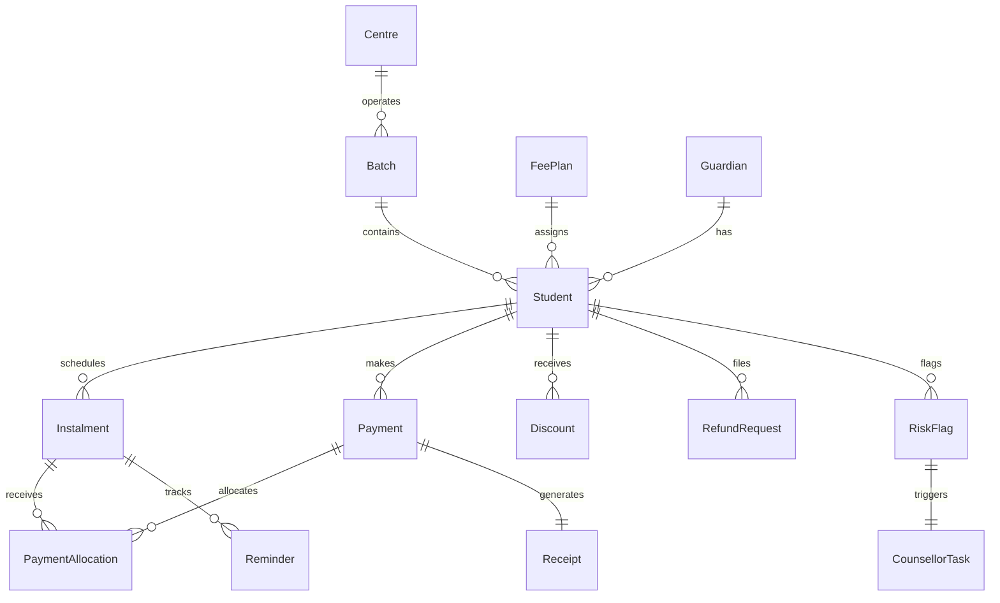

# Technical Design Document (TDD)
## Project: CoachFee — Coaching Institute Fee Management & Dues Collection Portal

- **Repository:** `[GITHUB_REPOSITORY_URL_PLACEHOLDER]` *(To be linked upon repo publishing)*
- **Live Deployment:** `[RENDER_DEPLOYMENT_URL_PLACEHOLDER]` *(Auto-deployed via Render blueprint)*
- **Client:** Company A, Jaipur (4 Centres, 2,600 Students, 140 Staff, ₹31.2 Cr Billed Annually)
- **Author:** Software Engineering Team

---

## 1. Executive Summary & Problem Context

Company A operates four coaching centres across Jaipur (Gopalpura Bypass, Vaishali Nagar, Malviya Nagar, and Raja Park). The institute bills ₹31.2 Crore annually (~2,600 students × ₹1.2 Lakh). 

Under the previous legacy workflow:
- Payment receipts were entered into a desktop fee software and posted manually to Tally.
- Instalment due dates sat in disconnected Excel sheets per centre.
- Accounts staff spent approximately 4 FTEs (₹16.8 Lakh/year cost) chasing fees over phone calls, while parents constantly phoned centres to ask their current balances.
- **Financial impact:** ₹62.4 Lakh (2% of annual billing) was never collected due to late or erratic follow-ups, and 12% of instalment values arrived over 60 days late. Total recurring loss: **₹79.2 Lakh annually**.

**CoachFee** solves this with an integrated, server-rendered fee ledger, parent OTP portal with a 5-second comprehension rule, automated WhatsApp/SMS reminders that halt instantly upon payment, an MoE 2024-compliant pro-rata refund calculator, and a rule-based dropout risk engine.

---

## 2. Architecture & Technology Rationale

```
Parent Mobile Browser (Low-End Devices) ──► Django 5 Server-Rendered + HTMX ◄── Accounts Executive Browser
                                                   │
                ┌──────────────────────────────────┼─────────────────────────────────┐
                │                                  │                                 │
           accounts app                       ledger app                        payments app
       (Guardian, OTP, Audit)             (Centres, FeePlans,               (PaymentLinks, Webhooks,
                │                         Students, Instalments)             Unmatched Queue)
                │                                  │                                 │
                ▼                                  ▼                                 ▼
         reminders app                        refunds app                        risk app
       (Stop-on-Pay Engine,               (MoE 2024 Calculator,             (Transparent 0-100 Rule
        Dual-Lang Templates)               10-day Deadline)                   Engine, Counsellor Tasks)
                │                                  │                                 │
                └──────────────────────────────────┼─────────────────────────────────┘
                                                   ▼
                                SQLite (Dev) / PostgreSQL (Prod)
```

### Why Django 5 + HTMX + Tailwind (No SPA, No Celery)?
1. **Low-End Phone Accessibility:** Parents in tier-2/3 cities use budget Android smartphones over intermittent 4G connections. Thick client single-page applications (React/Next.js) suffer from massive bundle sizes, long hydration delays, and battery drain. Server-rendered HTML with Tailwind CSS and lightweight HTMX provides near-instant first contentful paint (FCP < 500ms).
2. **Zero In-Memory Drift:** Financial systems cannot afford state synchronization drift between client-side stores (Redux) and backend databases. All balances, overdue days, and allocation states are derived strictly from database records on the server.
3. **Operational Simplicity:** Eliminating Celery and Redis dependencies reduces infrastructure failure points and keeps the stack well within the client's ₹6 Lakh budget and maintenance envelope. Scheduled tasks (reminders and risk evaluation) run via idempotent Django management commands triggered by standard cron.

---

## 3. Data Model & Database Relationships



### Key Models & Design Decisions:
- **Integer Paise Representation:** All financial values (`total_amount`, `amount`, `registration_fee`, `balance`) are stored as unsigned 64-bit integers (`PositiveBigIntegerField`) representing Indian paise (₹1 = 100 paise). Floating-point arithmetic is strictly prohibited across the codebase to prevent rounding discrepancies.
- **Derived Financial Truth:** Instalment status (`paid`, `partial`, `overdue`, `due`, `upcoming`), student balances, and days overdue are **never stored as static database columns**. They are derived on-the-fly via pure Python services from the sum of allocations and current dates.
- **Oldest-Due Payment Allocation:** When a payment arrives, the allocation engine sorts all student instalments by `due_date ASC, sequence ASC` and fills balances greedily from the oldest outstanding instalment.
- **Unmatched Payment Queue:** Any webhook or payment received without a verified payment link or with an invalid cryptographic signature is immediately quarantined in `UnmatchedPayment`. It is **never** permitted to mark an instalment paid automatically.

---

## 4. Main System Flows

### Flow A: Payment & Idempotent Webhook Verification
1. Parent views instalment and clicks **Pay Now**.
2. A unique `PaymentLink` with a cryptographic UUID token is generated.
3. Upon mock gateway completion, the gateway issues a signed webhook containing `gateway_ref`, `amount_paise`, and HMAC-SHA256 `signature`.
4. The endpoint verifies HMAC against `GATEWAY_HMAC_SECRET`.
5. **Idempotency Guarantee:** If `gateway_ref` was previously processed, the webhook returns `200 OK` immediately without duplicating database allocations or receipts.
6. A database transaction atomically:
   - Creates the `Payment`.
   - Allocates funds to instalments (oldest first).
   - Generates an official `Receipt` with GST 18% base/tax split.
   - Marks the `PaymentLink` as paid.
   - Writes an immutable record to `AuditLog`.

### Flow B: Scheduled Reminder Automation with Stop-On-Pay
1. The cron command `python manage.py send_reminders` executes daily.
2. The engine scans for instalments at specific target offsets: `-3` (before), `0` (on due date), `+1`, `+7`, and `+15` (overdue) days.
3. **Stop-On-Pay Check:** Immediately before formulating the message, the engine queries `PaymentAllocation` in real time. If `balance_paise <= 0`, the dispatch is aborted with zero notification sent.
4. **Duplicate Prevention:** A database constraint on `(instalment_id, day_offset)` ensures no instalment receives duplicate reminders for the same cadence trigger.
5. The message is formatted in the parent's registered language (`hi` or `en`) and logged to `MessageLog`.

### Flow C: Pro-Rata Refund Calculator (MoE 2024 Guidelines)
Under the Ministry of Education's 2024 Coaching Guidelines, coaching institutes must publish a transparent refund policy and execute refunds within 10 calendar days of student departure.

**Calculation Formula (Explicit Assumption):**
$$\text{Refund} = \max\Big(\text{Total Paid} - \text{Reg Fee} - \Big(\frac{\text{Days Attended}}{\text{Total Course Days}} \times \text{Tuition}\Big), 0\Big)$$
- Floored at ₹0 if retained amount exceeds total payments.
- Sets an immutable deadline: $\text{due\_by} = \text{leave\_date} + 10\text{ days}$.
- Accounts executive reviews computed breakdown before creating the formal `RefundRequest`.

---

## 5. Transparent Rule-Based Dropout-Risk Engine

### Ethical & Safety Constraints (Mandatory)
> [!CAUTION]
> **Safety Rule:** A risk flag must **NEVER** automatically trigger fee changes, penalties, or automated parent messages. Its sole output is a `CounsellorTask` for human pastoral intervention.

### Scoring Methodology (0 to 100 Points)
The risk engine evaluates three transparent objective indicators:

| Component | Max Points | Evaluation Logic |
|---|---|---|
| **Missed Instalments** | 40 | Overdue >45 days: 40 pts; >20 days: 30 pts; >7 days: 20 pts; else 0 pts |
| **Attendance Decline** | 30 | Compares recent 14-day attendance % vs prior 14 days. If recent <50%: 30 pts; drop ≥25%: 25 pts; drop ≥15%: 15 pts |
| **Declining Test Scores** | 30 | Compares latest test score % vs prior test score %. Drop ≥20%: 25 pts; drop ≥10%: 15 pts; latest <40%: 30 pts |

### Handling Edge Cases
- **Insufficient Data:** If a student has fewer than 3 attendance days or fewer than 2 test scores recorded, that component contributes 0 points and explicitly notes `"insufficient_data"` in the JSON audit trail.
- **False-Positive Suppression:** When a counsellor investigates and clicks **False Positive**, the flag status transitions to `false_flag`. The automated scanner suppresses repeat flagging for that student for a configurable period (30 days).

---

## 6. UI/UX Design Decisions

1. **5-Second Comprehension Rule for Parents:**
   - The parent portal eliminates all clutter: displays student name, total course fee, total paid, and **net outstanding balance** in bold contrast.
   - Each instalment displays amount, due date, overdue badges, and an immediate **Pay Now** button.
2. **Restrained Navy/Blue Palette:**
   - Primary: `#0f172a` (Slate 900) and `#1e3a5f` (Navy 800)
   - Accent: `#2563eb` (Blue 600)
   - Status: Muted semantic badges (Emerald for paid, Amber for due, Red for overdue).
3. **Accessibility for Low-End Mobile Screens:**
   - Mobile bottom bar navigation (`Dues`, `Receipts`, `Language Toggle`) with high touch-target heights (min 48px).
   - Instant language toggle (`English` ↔ `Hindi`) stored on the `Guardian` model.

---

## 7. Security, Privacy & Compliance

- **DPDP Act 2023 Compliance:** Because entrance coaching students are overwhelmingly minors, parent OTP login serves as the verifiable parental consent mechanism (`Guardian.consent_given = True`, `consent_version = 'DPDP-2023-V1'`).
- **Object-Level Permissions:**
  - Parent users can exclusively query and view students where `student.guardian.user == request.user`.
  - Accounts executives are strictly scoped to their assigned centre (`student.batch.centre == staff.centre`) unless flagged as institute administrators.
- **Cryptographic Webhook Verification:** HMAC-SHA256 signature verification guarantees gateway events originate from authorized payment networks.
- **CSRF & XSS Protection:** CSRF tokens required on all mutating POST forms; HTTPOnly session cookies; `X-Frame-Options: DENY`.

---

## 8. Verification & Test Coverage

The automated test suite (`python manage.py test`) covers 23 test cases:
1. `test_gst_breakdown_inclusive`: Base tuition and 18% GST calculation.
2. `test_instalment_status_and_overdue`: Accurate derivation of status, days overdue, and balances.
3. `test_partial_payment_allocation_oldest_first`: Priority allocation to earliest due dates.
4. `test_multiple_instalment_allocation`: Spanning payments across sequential instalments.
5. `test_overpayment_handling`: Leftover excess balance detection.
6. `test_discounts_and_balance_derivation`: Net balance calculations accounting for scholarships.
7. `test_ageing_buckets`: Segregation into 0–30, 31–60, and >60 day ageing brackets.
8. `test_parent_cannot_access_other_parent_student_ledger`: 404 enforcement on foreign student queries.
9. `test_centre_staff_cannot_view_other_centre_student`: 403 Forbidden enforcement on foreign centre queries.
10. `test_hmac_signature_verification`: Valid and tampered webhook signature handling.
11. `test_successful_webhook_processing_allocates_and_receipts`: End-to-end receipting and allocation.
12. `test_duplicate_webhook_idempotency`: Prevention of duplicate payment records.
13. `test_invalid_webhook_signature_sent_to_unmatched_queue`: Quarantining corrupt webhook events.
14. `test_unknown_payment_link_sent_to_unmatched_queue`: Quarantining unlinked transactions.
15. `test_pro_rata_refund_at_20_days_attended`: Pro-rata deduction + reg fee deduction verification.
16. `test_leaving_before_batch_start_date`: Full refund minus non-refundable registration fee.
17. `test_leaving_after_course_completion_floored_at_zero`: Non-negative balance floor check.
18. `test_reminder_message_templates_en_and_hi`: Dual-language copy formatting.
19. `test_stop_on_pay_suppresses_reminders`: Immediate cancellation of reminders when balance is cleared.
20. `test_duplicate_reminder_prevention`: Idempotency across daily reminder batches.
21. `test_insufficient_data_handles_gracefully`: Safe fallback for students without historical data.
22. `test_high_risk_scoring_and_task_generation`: Multi-factor composite risk scoring.
23. `test_false_positive_suppression`: 30-day repeat suppression for counsellor-dismissed flags.

---

## 9. Scoping Choices & Future Roadmap

### Features Purposely Deferred
- **Bulk CSV Upload of Attendance/Scores:** Deferred as permitted by the brief; student academics can be seeded directly or updated via Django admin/API.
- **Complex LMS / Video Platform:** Explicitly out of scope per brief.
- **External SMS/WhatsApp Gateway API Keys:** Mock logging implemented to avoid external provider billing and rate limit dependencies during evaluation.

### Future Enhancements (Post-MVP)
1. **Direct Tally XML Sync:** Replace CSV export with direct Tally Prime XML ODBC integration.
2. **Automated WhatsApp Interactive Buttons:** Integrate WhatsApp Cloud API interactive quick-reply payment buttons.
3. **Automated Pro-Rata Bank Payouts:** Integrate RazorpayX payout webhooks to disburse approved refunds directly to parent bank accounts within the 10-day window.
